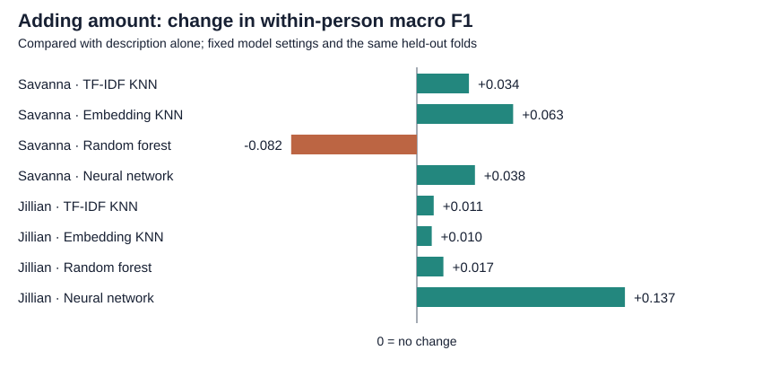

# Final Results: What Information Helps Categorize Transactions?

**Date:** November 19, 2026

## Original project questions

1. After cleaning and combining our personal bank statements into one dataset, which machine learning techniques most accurately categorize transactions into main categories and subcategories?
2. Can a model trained on one person's bank statements correctly categorize the statements of another?

### Questions guiding this report

To investigate the original questions, we focus on three comparisons:

1. Does adding amount, transaction type, or account to the description improve predictions within each person's data?
2. Do those features help when a model is trained on one person and tested on the other?
3. Which model performs best, particularly across less common categories?

This report evaluates main categories using each person's dataset separately; it does not evaluate subcategories or train a model on a combined dataset. The [answers to the original questions](#answers-to-the-original-project-questions) explain what the results can and cannot tell us.

## How to read these results

These experiments predict main categories for 998 Savanna and 393 Jillian labeled transactions. Macro F1 gives each category equal weight; accuracy is the share of predictions that are correct. For within-person results, predictions are pooled from five outer folds grouped by normalized description. For cross-person results, the whole labeled dataset of one person is used for training and the other's for testing.

The ablation uses fixed model settings and the same splits for each feature variant. The description-only column gives macro F1; the other columns show the change in macro F1 when that single feature is added. A positive change is better. TF-IDF KNN only tests amount; type and account are not tested for it. The baseline for each row is that same model with description alone. See the [complete aggregate and fold scores](tables/feature_ablation_scores.csv) for accuracy and exact values.

For the ablation, both KNN versions use five neighbors and cosine distance; the random forest uses 200 trees with no depth limit; and the neural network uses one 100-unit hidden layer, alpha 0.0001, a 0.001 learning rate, a 1,000-iteration limit, and early stopping. These settings are fixed, not retuned for each ablation variant.

## 1. Do extra features help within each person?

Adding amount improves macro F1 in 7 of the eight person/model comparisons. For example, the change is +0.118 for Jillian's TF-IDF KNN and -0.083 for Savanna's random forest. Transaction type and account also have mixed effects, so there is no evidence here that every extra field helps every model.

### Savanna

| Model | Description F1 | + Amount | + Type | + Account |
| --- | --- | --- | --- | --- |
| TF-IDF KNN | 0.466 | 0.032 | — | — |
| Embedding KNN | 0.421 | 0.063 | 0.016 | -0.068 |
| Random forest | 0.498 | -0.083 | -0.055 | -0.004 |
| Neural network | 0.556 | 0.038 | 0.007 | -0.015 |

### Jillian

| Model | Description F1 | + Amount | + Type | + Account |
| --- | --- | --- | --- | --- |
| TF-IDF KNN | 0.308 | 0.118 | — | — |
| Embedding KNN | 0.426 | 0.016 | 0.127 | 0 |
| Random forest | 0.271 | 0.008 | 0.012 | 0.014 |
| Neural network | 0.341 | 0.116 | -0.007 | 0.026 |

## 2. Do extra features transfer across people?

The effect depends on the training direction and model. For example, adding amount changes TF-IDF KNN macro F1 by -0.041 when training on Savanna and testing on Jillian, but by +0.033 in the other direction. Adding amount improves 6 of the eight cross-person comparisons. These small, uneven gains do not establish reliable transfer.

### Savanna to Jillian

| Model | Description F1 | + Amount | + Type | + Account |
| --- | --- | --- | --- | --- |
| TF-IDF KNN | 0.264 | -0.041 | — | — |
| Embedding KNN | 0.153 | 0.006 | 0.023 | 0.049 |
| Random forest | 0.164 | -0.025 | -0.054 | -0.021 |
| Neural network | 0.132 | 0.028 | 0.027 | 0.025 |

### Jillian to Savanna

| Model | Description F1 | + Amount | + Type | + Account |
| --- | --- | --- | --- | --- |
| TF-IDF KNN | 0.092 | 0.033 | — | — |
| Embedding KNN | 0.086 | 0.035 | 0.033 | 0 |
| Random forest | 0.044 | 0.032 | 0.033 | 0.002 |
| Neural network | 0.064 | 0.016 | 0.055 | -0.004 |

## 3. Which models performed best?

The table shows the highest observed macro F1 among the fixed-setting variants when training and testing within each person's data, and when training on one person and testing on the other. These are the highest observed values among the variants we tried, not unbiased estimates for a model chosen after looking at these results.

For example, ‘Savanna to Jillian’ means the model was trained on Savanna's transactions and tested on Jillian's. The reverse comparison trains on Jillian and tests on Savanna. The table also shows the most-common-category baseline for context. Cross-person leaders were selected after seeing the other person's test results and should be read as exploratory.

| Evaluation | Model | Features | Accuracy | Macro F1 | Baseline accuracy | Baseline macro F1 |
| --- | --- | --- | --- | --- | --- | --- |
| within: Savanna | Neural network | description + amount | 0.652 | 0.594 | 0.348 | 0.04 |
| within: Jillian | Embedding KNN | description + type | 0.606 | 0.553 | 0.623 | 0.077 |
| cross: Savanna to Jillian | TF-IDF KNN | description | 0.585 | 0.264 | 0.623 | 0.077 |
| cross: Jillian to Savanna | TF-IDF KNN | description + amount | 0.3 | 0.125 | 0.348 | 0.04 |

The tuned-model comparison evaluates feature selection and parameter tuning on each outer training set before making outer-test predictions. Its results answer how the whole selection procedure performs, whereas the fixed-setting ablation isolates the contribution of individual inputs. In the tuned comparison, Neural network had the highest within-person macro F1 for Savanna; Embedding KNN had the highest for Jillian. The selected features and parameters can differ by outer fold.

| Model | Savanna accuracy | Savanna macro F1 | Jillian accuracy | Jillian macro F1 |
| --- | --- | --- | --- | --- |
| Most-common baseline | 0.348 | 0.04 | 0.623 | 0.077 |
| TF-IDF KNN | 0.604 | 0.508 | 0.718 | 0.446 |
| Embedding KNN | 0.566 | 0.46 | 0.623 | 0.454 |
| Random forest | 0.598 | 0.501 | 0.672 | 0.279 |
| Neural network | 0.657 | 0.542 | 0.791 | 0.438 |

The tuned comparison's [within-person scores](tables/tuned_comparison_nov19_scores.csv), [cross-person scores](tables/tuned_comparison_nov19_cross_person.csv), and [fold selections](tables/tuned_comparison_nov19_selections.csv) are also saved as tables.

## Evaluation and limitations

For each outer training set, feature selection and parameter tuning use the same inner training–validation splits in two rounds. First, validation scores compare feature sets using fixed model settings. Then the chosen features are kept while the same validation rows help compare parameter settings. Those tuning scores are not an independent evaluation of both choices; the held-out outer test fold evaluates the complete selection procedure.

The tuned comparison fits feature preprocessing and oversamples rare categories only within each inner training split; inner validation and outer test rows are not oversampled. The selected model is then refit on the oversampled outer training data. Inner folds are stratified by category but do not group descriptions. When a category has only one row in an outer training set, feature selection and tuning fall back to the documented defaults.

The neural network also uses an internal early-stopping validation split after oversampling, so its early-stopping decision can see repeated rows. This does not put outer test rows into training, but is a limitation of the training procedure. Categories with very few examples have unstable scores, and the two people have different category and account coverage. The comparisons are exploratory; five correlated cross-validation folds and two people do not support a simple independent-fold t-test or a claim about all users.

Code: [ablation runner](../ml/feature_ablation.py) and [tuned comparison](../ml/model_comparison.py). Raw transactions and per-row predictions are not included in these result files.

To rerun with private labeled CSVs, run `python -m ml.feature_ablation --output results/tables/new_ablation_scores.csv` and `python -m ml.model_comparison --output results/new_tuned_comparison`. The ablation runner saves aggregate results as it progresses; `--resume` should only be used with the same data and settings.

## Summary of answers

1. **Within each person:** Adding amount improved macro F1 in 7 of eight person/model comparisons, but its effect varied by model. Type and account also had mixed effects. [See the within-person feature comparison](#1-do-extra-features-help-within-each-person).
2. **Across people:** Adding amount improved macro F1 in 6 of eight comparisons, but the changes depended on the model and training direction. The results do not establish reliable transfer. [See the cross-person comparison](#2-do-extra-features-transfer-across-people).
3. **Best model:** In the tuned within-person comparison, Neural network had the highest macro F1 for Savanna and Embedding KNN did for Jillian. Results vary with the evaluation and settings. [See the model comparison](#3-which-models-performed-best).

## Answers to the original project questions

**Which machine learning techniques most accurately categorize transactions into main categories and subcategories?** For the main categories, the tuned neural network had the highest within-person accuracy for both Savanna (0.657) and Jillian (0.791). When giving each category equal weight through macro F1, the neural network led for Savanna (0.542), while embedding KNN led for Jillian (0.454). The most accurate model overall is therefore not necessarily the one that performs best across categories. These experiments did not evaluate subcategory predictions, so they do not answer which technique works best for subcategories. They evaluated each person's data separately rather than training a model on a combined dataset. [See the tuned scores](tables/tuned_comparison_nov19_scores.csv).

**Can a model trained on one person's transactions categorize another person's transactions?** Partly, but the results do not show reliable transfer. In the tuned comparison, TF-IDF KNN achieved accuracy of 0.562 and macro F1 of 0.290 when trained on Savanna and tested on Jillian; the most-common-category baseline had higher accuracy (0.623). In the reverse direction, TF-IDF KNN achieved accuracy of 0.359 and macro F1 of 0.146, compared with baseline accuracy of 0.348. The differing category and account coverage and the small number of people limit what we can conclude. [See the cross-person scores](tables/tuned_comparison_nov19_cross_person.csv).
