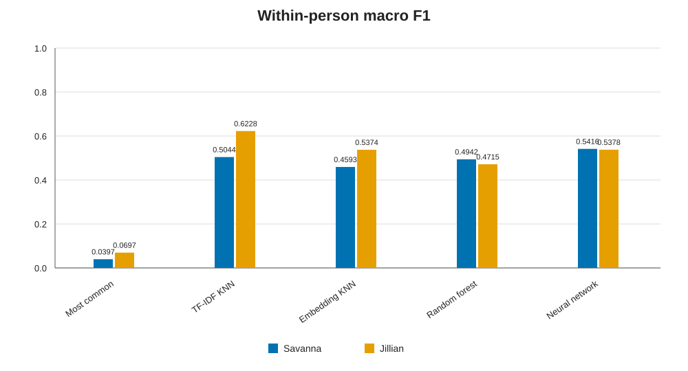

# Final Results: What Information Helps Categorize Transactions?

**Date:** November 19, 2026

## Original project questions

1. After cleaning and combining our personal bank statements into one dataset, which machine learning techniques most accurately categorize transactions into main categories and subcategories?
2. Can a model trained on one person's bank statements correctly categorize the statements of another?

### Questions guiding this report

To investigate the original questions, we focus on three comparisons:

1. Does adding amount, transaction type, or account to the description improve predictions within each person's data?
2. Do those features help when a model is trained on one person and tested on the other?
3. Which model performs best, particularly across less common categories?

This report evaluates main categories using each person's dataset separately; it does not evaluate subcategories or train a model on a combined dataset. The [answers to the original questions](#answers-to-the-original-project-questions) explain what the results can and cannot tell us.

## How to read these results

These experiments predict main categories for 998 Savanna and 668 Jillian labeled transactions. Macro F1 gives each category equal weight; accuracy is the share of predictions that are correct. For within-person results, predictions are pooled from five outer folds grouped by normalized description. For cross-person results, the whole labeled dataset of one person is used for training and the other's for testing. Jillian’s current dataset includes 393 credit-card and 275 checking transactions, including transactions labeled as transfers; 10 completely empty spreadsheet rows were excluded.

The ablation uses fixed model settings and the same splits for each feature variant. The description-only column gives macro F1; the other columns show the change in macro F1 when that single feature is added. A positive change is better. TF-IDF KNN only tests amount; type and account are not tested for it. The baseline for each row is that same model with description alone. See the [complete aggregate and fold scores](tables/feature_ablation_scores.csv) for accuracy and exact values.

For the ablation, both KNN versions use five neighbors and cosine distance; the random forest uses 200 trees with no depth limit; and the neural network uses one 100-unit hidden layer, alpha 0.0001, a 0.001 learning rate, a 1,000-iteration limit, and early stopping. These settings are fixed, not retuned for each ablation variant.

## 1. Do extra features help within each person?

Adding amount improves macro F1 in 6 of 8 person/model comparisons. For example, its change is +0.046 for Jillian's TF-IDF KNN and -0.083 for Savanna's random forest. Type and account have model-dependent effects; these comparisons do not show that every extra field helps every model.

### Savanna

| Model | Description F1 | + Amount | + Type | + Account |
| --- | --- | --- | --- | --- |
| TF-IDF KNN | 0.466 | +0.032 | — | — |
| Embedding KNN | 0.421 | +0.063 | +0.016 | -0.068 |
| Random forest | 0.498 | -0.083 | -0.055 | -0.004 |
| Neural network | 0.556 | +0.038 | +0.007 | -0.015 |

### Jillian

| Model | Description F1 | + Amount | + Type | + Account |
| --- | --- | --- | --- | --- |
| TF-IDF KNN | 0.532 | +0.046 | — | — |
| Embedding KNN | 0.609 | -0.021 | -0.006 | -0.045 |
| Random forest | 0.485 | +0.015 | +0.005 | +0.010 |
| Neural network | 0.598 | +0.015 | +0.027 | +0.016 |

## 2. Do extra features transfer across people?

The effect depends on the training direction and model. Adding amount changes TF-IDF KNN macro F1 by +0.062 when training on Savanna and testing on Jillian, and by -0.013 in the other direction. It improves 6 of 8 cross-person comparisons. These comparisons alone do not establish reliable transfer.

### Savanna to Jillian

| Model | Description F1 | + Amount | + Type | + Account |
| --- | --- | --- | --- | --- |
| TF-IDF KNN | 0.188 | +0.062 | — | — |
| Embedding KNN | 0.154 | +0.051 | +0.034 | +0.032 |
| Random forest | 0.139 | +0.007 | +0.008 | -0.017 |
| Neural network | 0.158 | +0.012 | +0.040 | +0.036 |

### Jillian to Savanna

| Model | Description F1 | + Amount | + Type | + Account |
| --- | --- | --- | --- | --- |
| TF-IDF KNN | 0.160 | -0.013 | — | — |
| Embedding KNN | 0.121 | -0.004 | +0.029 | -0.005 |
| Random forest | 0.079 | +0.052 | +0.035 | +0.002 |
| Neural network | 0.126 | +0.021 | +0.042 | +0.018 |

## 3. Which models performed best?

The table shows the highest observed macro F1 among the fixed-setting variants when training and testing within each person's data, and when training on one person and testing on the other. These are exploratory winners selected after looking at the results, not unbiased estimates for a model chosen in advance. “Savanna to Jillian” means training on Savanna and testing on Jillian; the reverse uses Jillian for training and Savanna for testing. The most-common-category baseline provides context.

| Evaluation | Model | Features | Accuracy | Macro F1 | Baseline accuracy | Baseline macro F1 |
| --- | --- | --- | --- | --- | --- | --- |
| within: Savanna | Neural network | description + amount | 0.652 | 0.594 | 0.348 | 0.040 |
| within: Jillian | Neural network | description + type | 0.753 | 0.625 | 0.464 | 0.063 |
| cross: Savanna to Jillian | TF-IDF KNN | description + amount | 0.484 | 0.249 | 0.464 | 0.063 |
| cross: Jillian to Savanna | Neural network | description + type | 0.388 | 0.168 | 0.348 | 0.040 |

The tuned-model comparison selects features and parameters using each outer training set before predicting its held-out rows. It evaluates the whole selection procedure, while the fixed-setting ablation isolates individual inputs. In the tuned within-person comparison, neural network had the highest macro F1 for Savanna and embedding KNN had the highest for Jillian. Features and parameters can differ by outer fold.

| Model | Savanna accuracy | Savanna macro F1 | Jillian accuracy | Jillian macro F1 |
| --- | --- | --- | --- | --- |
| Most-common baseline | 0.348 | 0.040 | 0.464 | 0.063 |
| TF-IDF KNN | 0.604 | 0.508 | 0.759 | 0.594 |
| Embedding KNN | 0.567 | 0.460 | 0.762 | 0.612 |
| Random forest | 0.598 | 0.501 | 0.754 | 0.506 |
| Neural network | 0.657 | 0.542 | 0.781 | 0.578 |

The tuned comparison's [within-person scores](tables/tuned_comparison_nov19_scores.csv), [cross-person scores](tables/tuned_comparison_nov19_cross_person.csv), and [fold selections](tables/tuned_comparison_nov19_selections.csv) are also saved as tables.

## Evaluation and limitations

For each outer training set, feature selection and parameter tuning use the same inner training–validation splits in two rounds. First, validation scores compare feature sets using fixed model settings. Then the chosen features are kept while the same validation rows help compare parameter settings. Those tuning scores are not an independent evaluation of both choices; the held-out outer test fold evaluates the complete selection procedure.

During feature selection and parameter tuning, each inner fold fits data-dependent preprocessing—such as amount standardization and the TF-IDF vocabulary—using only that fold's inner training rows. It then oversamples rare categories in those same training rows. The inner validation rows are transformed using the training-fitted preprocessing and are not oversampled. The pretrained sentence-embedding model is used as-is and is not fitted to our transactions.

After selecting the features and parameters, the code fits preprocessing again using the **whole outer training set**, oversamples its rare categories, and refits the selected model. It applies that training-fitted preprocessing to the held-out outer test rows without oversampling them. Inner folds are stratified by category but do not group descriptions. When a category has only one row in an outer training set, feature selection and tuning fall back to the documented defaults.

The neural network also uses an internal early-stopping validation split after oversampling, so its early-stopping decision can see repeated rows. This does not put outer test rows into training, but is a limitation of the training procedure. Categories with very few examples have unstable scores, and the two people have different category and account coverage. The comparisons are exploratory; five correlated cross-validation folds and two people do not support a simple independent-fold t-test or a claim about all users.

Code: [ablation runner](../ml/feature_ablation.py) and [tuned comparison](../ml/model_comparison.py). Raw transactions and per-row predictions are not included in these result files.

To rerun with private labeled CSVs, run `python -m ml.feature_ablation --output results/tables/new_ablation_scores.csv` and `python -m ml.model_comparison --output results/new_tuned_comparison`. The ablation runner saves aggregate results as it progresses; `--resume` should only be used with the same data and settings.

## Summary of answers

1. **Within each person:** Adding amount improved macro F1 in 6 of 8 person/model comparisons. Its effect varies by model; see the [within-person feature comparison](#1-do-extra-features-help-within-each-person).
2. **Across people:** Adding amount improved macro F1 in 6 of 8 comparisons. The effects depend on the model and training direction; see the [cross-person comparison](#2-do-extra-features-transfer-across-people).
3. **Best model:** In the tuned within-person comparison, neural network had the highest macro F1 for Savanna and embedding KNN did for Jillian. See the [model comparison](#3-which-models-performed-best).

## Answers to the original project questions

**Which machine learning techniques most accurately categorize transactions into main categories and subcategories?** For main categories, the tuned model with the highest within-person accuracy was neural network for Savanna (0.657) and neural network for Jillian (0.781). By macro F1, neural network led for Savanna (0.542) and embedding KNN led for Jillian (0.612). These experiments did not evaluate subcategories or train a model on a combined dataset. [See the tuned scores](tables/tuned_comparison_nov19_scores.csv).

**Can a model trained on one person's transactions categorize another person's transactions?** The results show partial transfer, but performance depends on the direction and metric. Tuned TF-IDF KNN achieved accuracy / macro F1 of 0.422 / 0.229 training on Savanna and testing on Jillian, and 0.383 / 0.160 in the reverse direction. The corresponding most-common baseline accuracies were 0.464 and 0.348. Different category and account coverage, and data from only two people, limit generalization. [See the cross-person scores](tables/tuned_comparison_nov19_cross_person.csv).
